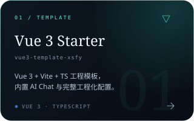
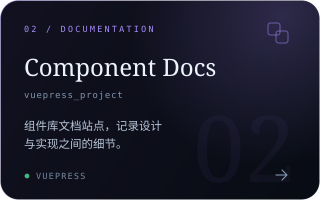
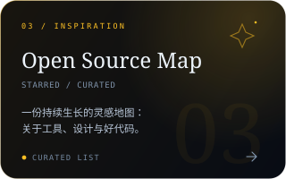
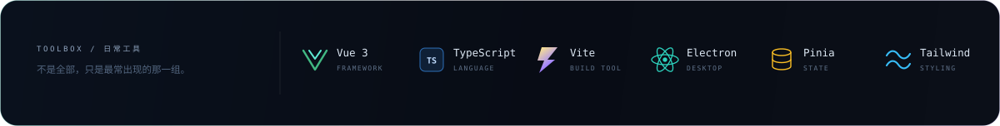
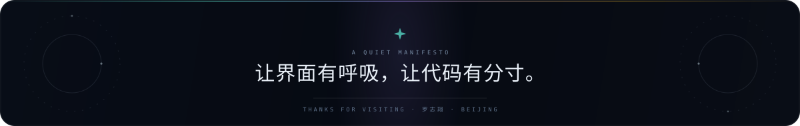

  

  
  &nbsp;
  
  &nbsp;
  

## 01 — 关于我

> 把复杂留给架构，把简单留给用户。

前端开发者，常驻北京。喜欢在 **Vue 生态** 里打磨产品，也着迷于组件设计、交互细节与工程化带来的秩序感。

对我来说，好的界面不只是「能用」——它应该有节奏、有呼吸，也有恰到好处的克制。

| 在做 | 在研究 | 在相信 |
| :---: | :---: | :---: |
| Vue 3 应用与 Electron 桌面端 | 设计系统与界面动效 | 清晰胜过聪明 |

## 02 — 精选作品

  
  
  

## 03 — 技术栈

  

## 04 — 此刻

- 持续打磨 **Vue 3 + Electron** 的桌面端体验
- 对 **设计系统、界面动效、前端工程化** 保持长期好奇
- 喜欢把想法从「能跑」推进到「好用、好看、好维护」

  

